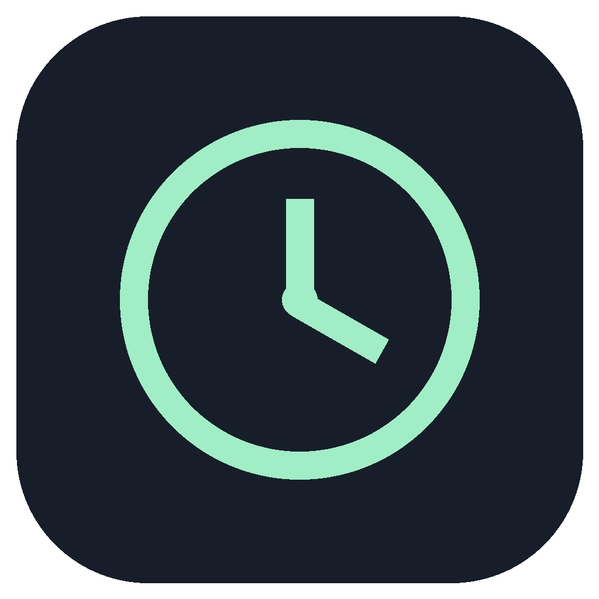
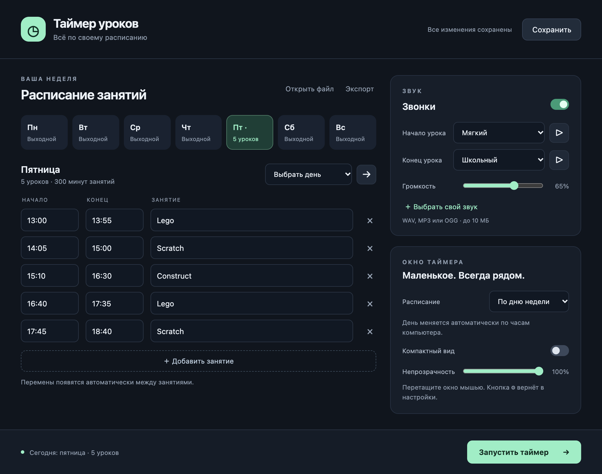
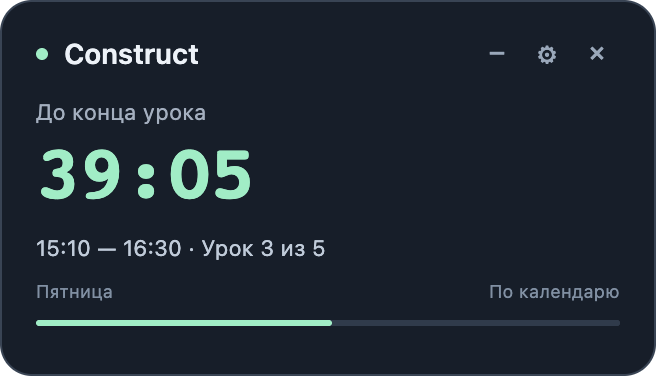
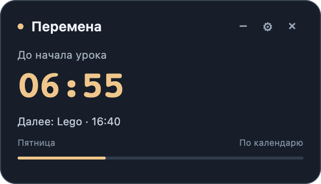
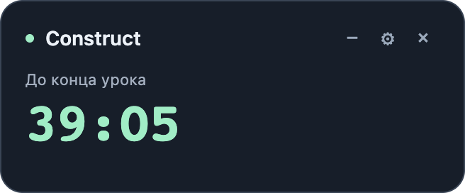

<div align="center">
  
  <h1>LessonTimer</h1>
  <p><strong>Расписание под рукой. Время урока — перед глазами.</strong></p>
  <p>Плавающий таймер уроков и перемен для Windows и macOS.</p>
  <p><a href="https://github.com/egorca05/LessonTimer---/releases">Скачать</a> · <a href="docs/USER_GUIDE.md">Руководство</a> · <a href="docs/DEVELOPMENT.md">Для разработчиков</a> · <a href="LICENSE">MIT</a></p>
</div>



LessonTimer помогает вести занятия без постоянного взгляда на часы. Составьте расписание на неделю, выберите звонок и запустите маленькое окно поверх приложений. Оно покажет текущий предмет и время до конца урока, а на перемене — время до следующего занятия.

Подходит для преподавателей, репетиторов, кружков и самостоятельных занятий. Для работы не нужны аккаунт, интернет, Python или .NET.

## Возможности

| Функция                 | Как работает                                                                     |
| ----------------------- | -------------------------------------------------------------------------------- |
| Расписание на неделю    | Отдельный список уроков для каждого из семи дней                                 |
| Автоматические перемены | Промежутки между занятиями рассчитываются сами                                   |
| Окно поверх приложений  | Перетаскивание мышью, обычный и компактный вид                                   |
| Звонки                  | Три встроенных звука, свой WAV/MP3/OGG, отдельный выбор для начала и конца урока |
| Удобный ввод времени    | Только цифры, двоеточие добавляется автоматически: `1330` → `13:30`              |
| Проверка расписания     | Защита от пересечений, неправильного времени и пустых названий                   |
| Копирование дней        | Перенос расписания в другой день или сразу во все будни                          |
| Два режима              | По календарю компьютера или по выбранному дню недели                             |
| Настройка окна          | Непрозрачность, компактный вид и сохранение положения                            |
| Перенос данных          | Экспорт и импорт расписания, настроек и своего звука одним JSON-файлом           |

## Как выглядит таймер

|                 Во время урока                 |                   На перемене                    |
| :--------------------------------------------: | :----------------------------------------------: |
|  |  |

**Компактный вид** — только название занятия и обратный отсчёт:



Скриншоты сняты с интерфейса приложения на демонстрационном расписании. Это не нарисованные макеты. [Как переснять скриншоты](docs/DEVELOPMENT.md#скриншоты).

## Скачать и установить

Готовые программы размещаются в разделе [Releases](https://github.com/egorca05/LessonTimer---/releases). Если релиз ещё не опубликован, приложение можно запустить из исходников по инструкции ниже.

| Компьютер                  | Что скачать                   | Установка                                         |
| -------------------------- | ----------------------------- | ------------------------------------------------- |
| Windows 10/11, x64         | `LessonTimer-…-win-x64.exe`   | Запустить установщик, выбрать папку и ярлыки      |
| Windows, переносная версия | `LessonTimer-…-win-x64.zip`   | Распаковать всю папку и открыть `LessonTimer.exe` |
| Mac с M1/M2/M3/M4 и новее  | `LessonTimer-…-mac-arm64.dmg` | Перетащить LessonTimer в «Программы»              |
| Mac с Intel                | `LessonTimer-…-mac-x64.dmg`   | Перетащить LessonTimer в «Программы»              |

macOS: **13 или новее**. Установщики без доверенной подписи разработчика могут вызвать предупреждение системы; подробности — в [руководстве](docs/USER_GUIDE.md#первый-запуск-и-предупреждения-системы).

## Быстрый старт

1. Выберите день недели и добавьте занятия.
2. Введите время четырьмя цифрами, например `1405` и `1500`, и название предмета.
3. Выберите звуки начала и конца урока.
4. Нажмите **«Сохранить»**, затем **«Запустить таймер»**.
5. Перетащите окно в удобное место. Кнопка **⚙** вернёт к расписанию, **−** переключит компактный вид.

При первом запуске в текущий день добавлено демонстрационное расписание из пяти занятий. Другие дни пустые. Все занятия можно изменить или удалить.

## Данные и ограничения

Расписание хранится локально, отдельно от файлов программы. Обновление приложения и обычное удаление через установщик Windows сохраняют пользовательские данные. Перед переносом на другой компьютер сделайте **«Экспорт»**.

Звонки звучат, пока таймер запущен и компьютер не спит. Программа не будит компьютер. Некоторые полноэкранные приложения и защищённые системные экраны могут перекрывать таймер. Занятия через полночь не поддерживаются.

## Запуск из исходников

Нужны Node.js **22.14+** и npm; для CI используется Node.js 24.

```sh
npm ci
npm start
```

Проверки и сборка:

```sh
npm test
npm run check
npm run build:win       # установщик и ZIP для Windows x64
npm run build:mac       # DMG и ZIP для Mac Apple Silicon
npm run build:mac:intel # DMG и ZIP для Mac Intel
```

Windows рекомендуется собирать на Windows, macOS — на Mac. Готовые файлы появляются в `dist/`. В репозитории настроены [проверки](.github/workflows/ci.yml) и [сборка установщиков](.github/workflows/release.yml) через GitHub Actions. [Процесс выпуска версии](docs/RELEASING.md).

## Структура проекта

| Папка           | Содержимое                                                   |
| --------------- | ------------------------------------------------------------ |
| `src/main/`     | Окна Electron, сохранение данных, звук и безопасный IPC-мост |
| `src/renderer/` | Редактор расписания и плавающее окно                         |
| `src/shared/`   | Расчёт расписания, проверка данных и маска ввода времени     |
| `assets/`       | Иконки и встроенные звонки                                   |
| `build/`        | Подготовка установочного пакета перед подписью               |
| `docs/`         | Руководства и скриншоты                                      |
| `scripts/`      | Проверки проекта, скриншоты и контрольные суммы              |
| `tests/`        | Проверки логики и интерфейса                                 |
| `.github/`      | CI, выпуск установщиков и шаблоны обращений                  |

## Помочь проекту

Нашли ошибку — создайте Issue, укажите версию приложения, систему и шаги воспроизведения. Особенно полезны сведения о масштабе экрана и полноэкранном режиме. [Правила внесения изменений](CONTRIBUTING.md).

Исходный код распространяется по лицензии [MIT](LICENSE). История изменений — в [CHANGELOG.md](CHANGELOG.md).

---

**English:** LessonTimer is an offline weekly lesson planner with an always-on-top countdown, automatic breaks and customizable bells. Desktop builds target Windows x64 and macOS Apple Silicon / Intel. The interface and user documentation are currently in Russian.
