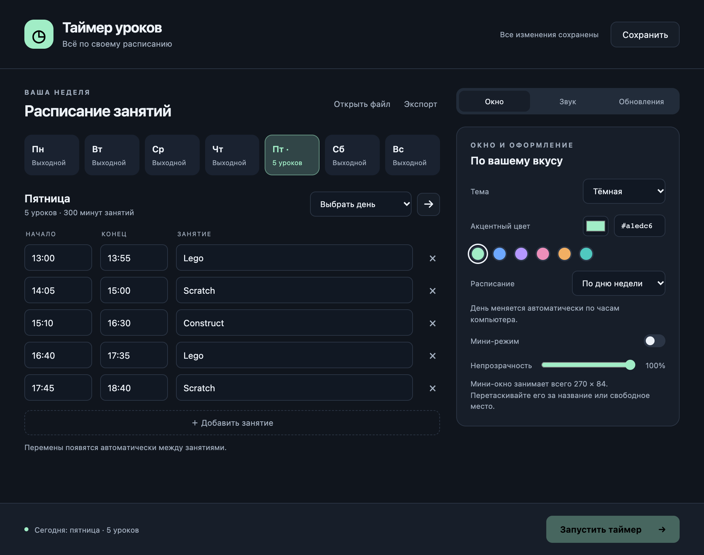
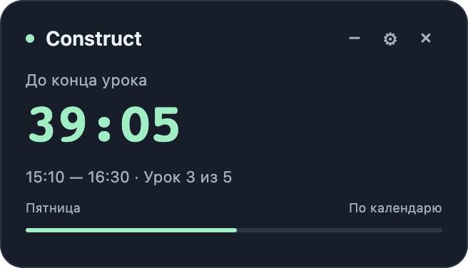
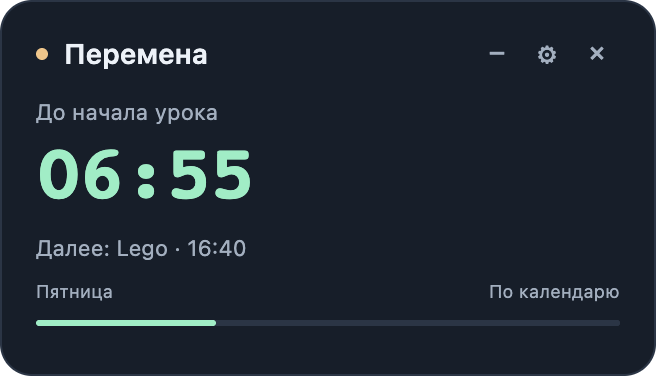
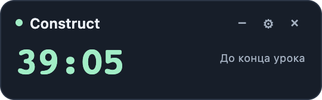

# Руководство пользователя

[← К описанию проекта](../README.md)

## Установка

### Windows

Скачайте установщик `.exe` для Windows x64 из Releases. Закройте уже запущенный LessonTimer, откройте установщик и следуйте его шагам. Можно выбрать папку установки и создать ярлыки.

Если установка не нужна, скачайте ZIP, распакуйте **всё его содержимое** в отдельную папку и запустите `LessonTimer.exe`. Соседние DLL-файлы и папка `resources` необходимы для работы — переносить один exe отдельно нельзя.

### macOS

Нужна macOS 13 или новее. Для Mac с чипами M1 и новее выберите `arm64`, для Intel — `x64`. Архитектура указана в названии файла.

Откройте DMG и перетащите значок LessonTimer на значок «Программы». Дождитесь копирования, извлеките образ и запустите приложение из «Программ».

### Первый запуск и предупреждения системы

Публичная сборка без купленного сертификата Windows и нотариальной проверки Apple может отображаться как приложение неизвестного разработчика.

В Windows при появлении SmartScreen проверьте, что файл взят из нужного репозитория. Если система предлагает соответствующие действия, откройте «Подробнее» и выберите «Выполнить в любом случае».

В macOS, если запуск заблокирован, после попытки открыть приложение зайдите в «Системные настройки → Конфиденциальность и безопасность» и используйте «Всё равно открыть», если кнопка доступна. Не требуется отключать защиту системы целиком. В управляемой школьной или рабочей системе запуск может ограничивать администратор.

## Главное меню

При запуске открывается редактор. Слева находятся дни недели и занятия, справа — звук и параметры плавающего окна. Внизу показано, какое расписание будет использовать таймер.

При первом запуске исходные пять занятий добавляются **только в текущий день**. Остальные дни считаются выходными, пока вы не добавите в них занятия.

## Создание расписания

1. Выберите день: Пн, Вт, Ср, Чт, Пт, Сб или Вс.
2. Нажмите «Добавить занятие».
3. Введите время начала и окончания, затем название.
4. Повторите для остальных уроков и нажмите «Сохранить».

Время вводится четырьмя цифрами: `0945` превращается в `09:45`, `1330` — в `13:30`. После двух цифр двоеточие появляется автоматически. Буквы не принимаются. При вставке остаются только цифры; берутся первые четыре.

Можно выделить часы или минуты и заменить их. Для полного изменения выделите поле целиком. Клавиши Backspace и Delete удаляют цифры.

При сохранении приложение сортирует занятия по времени и проверяет данные:

- часы — от 00 до 23, минуты — от 00 до 59;
- название занятия должно быть заполнено;
- конец должен быть позже начала в тот же день;
- занятия не должны пересекаться;
- максимум — 60 занятий на день.

При ошибке появится подсказка, изменения не будут сохранены. Нажмите × справа от строки, чтобы удалить занятие. Чтобы сделать день выходным, удалите все его занятия и сохраните расписание.

### Копирование расписания

Откройте день-источник, выберите другой день в списке над таблицей и нажмите →. Также можно выбрать «Все будни (Пн–Пт)». Если в целевых днях уже есть занятия, приложение попросит подтвердить замену. После копирования нажмите «Сохранить».

### Перемены

Перемены добавлять не нужно. Если урок заканчивается в 13:55, а следующий начинается в 14:05, приложение покажет десятиминутную перемену. Если занятия идут подряд, отдельной перемены не будет.

## Какое расписание используется

В блоке «Окно таймера» есть два режима.

| Режим          | Поведение                                                                                                                    |
| -------------- | ---------------------------------------------------------------------------------------------------------------------------- |
| По дню недели  | Используется сегодняшний день по локальным часам компьютера. В полночь день меняется автоматически                           |
| Выбранный день | Используется открытый в редакторе день, но часы остаются текущими. Можно, например, проверить субботнее расписание в пятницу |

В режиме «По дню недели» выбор вкладки в редакторе нужен только для редактирования. Он сам по себе не переключает расписание работающего таймера. Проверьте строку внизу меню перед запуском.

## Окно таймера

Нажмите «Запустить таймер». Текущие изменения сохранятся, редактор скроется и появится небольшое окно.

| Состояние              | Что отображается                                                 |
| ---------------------- | ---------------------------------------------------------------- |
| До первого урока       | Отсчёт до начала и название следующего занятия                   |
| Во время урока         | Название предмета и «До конца урока»                             |
| На перемене            | «Перемена», отсчёт до начала следующего урока и его название     |
| После последнего урока | «Занятия завершены» и ближайшее следующее занятие, если оно есть |
| День без уроков        | «Сегодня без уроков»                                             |

Обратный отсчёт показывает **минуты и секунды**. Например, `80:00` означает 80 минут, а не часы.

|            Обычный вид            |               Перемена               |              Компактный вид              |
| :-------------------------------: | :----------------------------------: | :--------------------------------------: |
|  |  |  |

### Управление окном

| Действие                                  | Результат                                                         |
| ----------------------------------------- | ----------------------------------------------------------------- |
| Перетаскивание за свободное место         | Перемещает окно; положение сохраняется                            |
| Кнопка −                                  | Включает или выключает компактный вид и меняет размер самого окна |
| Кнопка ⚙                                  | Открывает редактор расписания                                     |
| Кнопка × на таймере                       | Закрывает таймер и возвращает редактор                            |
| Закрытие редактора при работающем таймере | Скрывает редактор, таймер продолжает работать                     |

В меню можно настроить непрозрачность от 55 до 100%. Для полного выхода используйте «Выход» через значок в системном трее Windows / строке меню macOS или «Завершить LessonTimer» на Mac. При выходе с несохранёнными изменениями появится предупреждение.

## Оформление

Во вкладке «Окно» выберите светлую, тёмную или системную тему. Для акцента нажмите цветной квадрат: откроется системная палитра, где можно выбрать любой цвет. Также доступны готовые цвета и поле HEX, например `#4979e8`. Нажмите «Сохранить», чтобы применить оформление к плавающему таймеру.

Мини-режим занимает 270×84 логических пикселя и переключается кнопкой «−» на таймере или настройкой в меню. На Mac окно использует режим панели поверх рабочих столов и полноэкранных приложений. Некоторые системные экраны могут его перекрывать.

## Звонки

Доступны три встроенных звука: «Мягкий», «Школьный» и «Электронный». Для начала и конца урока можно выбрать разные звуки или «Без звука». Общий переключатель отключает все автоматические сигналы. Кнопка ▷ позволяет послушать выбранный звук, ползунок меняет громкость.

### Свой звук

Нажмите «Выбрать свой звук» и откройте WAV, MP3 или OGG размером до 10 МБ. Рекомендуется короткий WAV PCM или MP3. Файл копируется в данные программы, поэтому исходный файл можно перенести.

После выбора свой звук назначается **началу урока**. Для окончания выберите «Свой файл» во втором списке. Нажмите «Сохранить».

Сигналы звучат при переходе между состояниями. Если занятия идут подряд, проигрывается сигнал начала следующего. При открытии таймера посреди урока и после длительного сна пропущенные звонки не воспроизводятся. Сигнал не прозвучит, если таймер закрыт или компьютер выключен / спит.

## Сохранение, перенос и обновление

Используйте «Сохранить» после изменения расписания или настроек. Положение окна сохраняется автоматически при перемещении.

«Экспорт» сохраняет расписание на неделю, параметры и выбранный пользовательский звук в один JSON-файл. Экспорт также сохраняет текущие корректные изменения редактора. На другом компьютере нажмите «Открыть файл» и выберите этот JSON. Текущая неделя и настройки будут заменены, поэтому при необходимости сначала экспортируйте их.

Экспорт работает между Windows и Mac. Положение окна не переносится.

| Система | Где хранятся данные                          |
| ------- | -------------------------------------------- |
| Windows | `%APPDATA%/LessonTimer/`                     |
| macOS   | `~/Library/Application Support/LessonTimer/` |

Внутри — папка загруженных обновлений `updates`, файл `schedule-v2.json` и копия своего звука `custom-sound`, если он выбран. Перед обновлением полезно сделать экспорт. Закройте программу, установите новую версию или замените папку переносной сборки. Настройки лежат отдельно и сохраняются. Установщик Windows также настроен на сохранение данных при удалении программы.

## Автоматическое обновление

Начиная с 2.2.0 LessonTimer проверяет GitHub при открытии. При наличии новой стабильной версии появится предложение «Обновить» или «Позже». После согласия приложение скачает файл, сверит контрольную сумму и установит обновление с перезапуском. Удалять старую версию не нужно, расписание и звонок остаются на месте.

Во вкладке «Обновления» можно проверить версию вручную, отменить загрузку и отключить проверку при запуске. Без интернета таймер продолжает работать. Неудачную проверку можно повторить позже.

- **Windows:** нужна версия, установленная через `.exe`. Переносная ZIP-сборка предложит открыть Releases; её папку заменяют вручную при закрытом приложении.
- **Mac:** сначала перенесите `.app` из DMG в «Программы» и запустите оттуда. Нужны права записи в папку установки. При неудачном запуске после обновления автоматически восстанавливается предыдущая версия.
- **2.1.0 и старее:** обновитесь вручную до 2.2.0 один раз. После этого новые версии будут предлагаться внутри приложения.

Сборки пока не имеют доверенного сертификата издателя / нотариальной проверки Apple. Проверка SHA-256 обнаруживает повреждение файла, но не заменяет доверенную подпись разработчика.

## Если что-то не работает

| Проблема                              | Что проверить                                                                                         |
| ------------------------------------- | ----------------------------------------------------------------------------------------------------- |
| Показывается не тот день              | Режим «По дню недели / Выбранный день», часы и часовой пояс компьютера                                |
| Урок не появился                      | Выбран ли правильный день, сохранены ли изменения, нет ли ошибки времени                              |
| Нет звука                             | Запущен ли таймер, включены ли сигналы, выбран ли звук, ненулевая ли громкость в приложении и системе |
| Свой звук не проигрывается            | Попробуйте другой короткий WAV PCM или MP3 и выберите файл повторно                                   |
| Таймер скрыт полноэкранной программой | Попробуйте оконный режим; некоторые приложения и защищённые экраны могут перекрывать таймер           |
| Не удаётся уменьшить окно             | Установите версию 2.0.2 или новее; в ней исправлено переключение компактного режима в Windows         |
| Программа кажется большой по размеру  | В сборку включён Electron, поэтому отдельно устанавливать среду выполнения не требуется               |

Если проблема повторяется, создайте Issue с версией, системой, масштабом экрана и шагами воспроизведения. Скриншот можно приложить после удаления личных данных.
